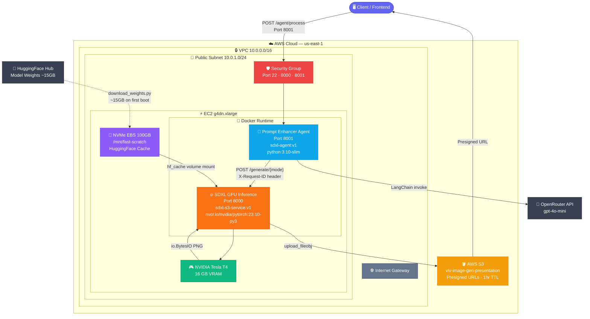
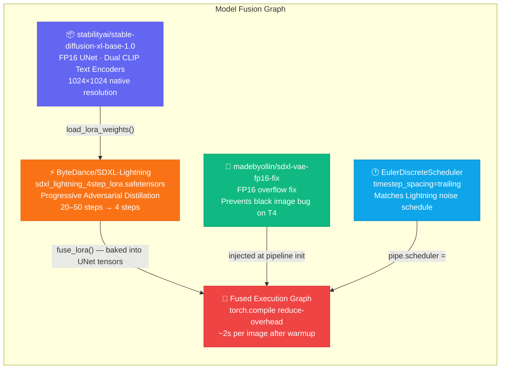
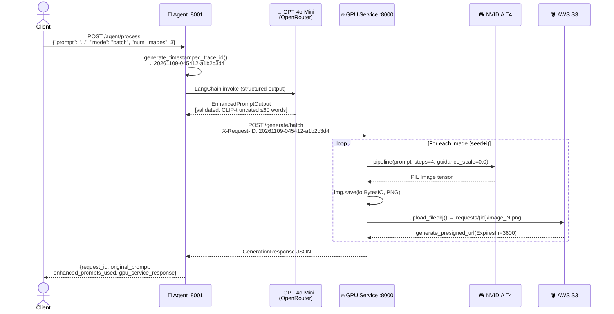
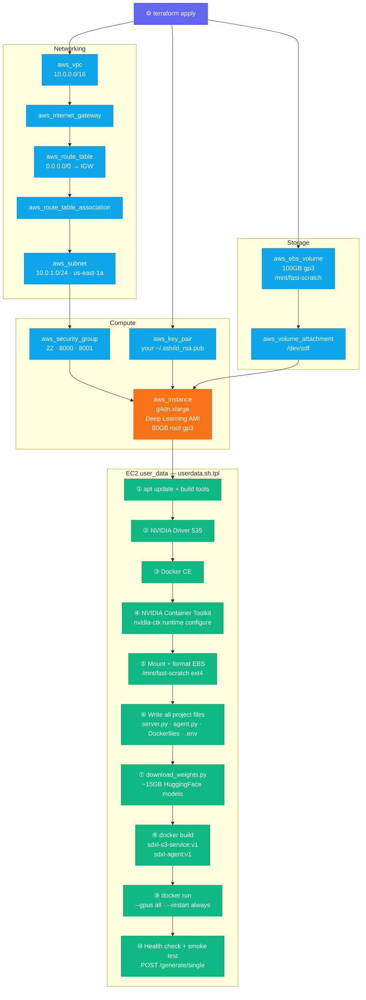

# 🎨 SDXL Lightning — GPU Image Generation Service

> **Fully automated, one-command deployment** of a production-grade AI image generation system on AWS `g4dn.xlarge` (NVIDIA Tesla T4). Terraform provisions everything — VPC, EC2, storage, NVIDIA drivers, Docker containers, model weights — and starts both microservices automatically.

---

## 📐 System Architecture



---

## 🧠 AI Model Pipeline



---

## 🔄 Request Lifecycle



---

## 🏗️ Terraform Infrastructure



---

## 📁 Project Structure

```
Image_generation/
│
├── 📄 server.py                    # FastAPI GPU inference engine (Port 8000)
├── 📄 Dockerfile                   # nvcr.io/nvidia/pytorch:23.10-py3 base
├── 📄 requirements.txt             # Pinned Python deps (torch, diffusers, boto3...)
├── 📄 download_weights.py          # Pre-fetches ~15GB model weights to NVMe
├── 📄 .env                         # AWS keys for GPU service ← fill this
│
├── prompt_enhancer/
│   ├── 📄 agent.py                 # LangChain prompt enhancer (Port 8001)
│   ├── 📄 Dockerfile               # python:3.10-slim base
│   ├── 📄 requirements.txt         # LangChain + FastAPI deps
│   └── 📄 .env                     # OpenRouter key + SDXL_SERVICE_URL ← fill this
│
├── terraform/
│   ├── 📄 main.tf                  # VPC · SG · EC2 · EBS · Key Pair
│   ├── 📄 variables.tf             # All input variables
│   ├── 📄 outputs.tf               # Public IP · SSH cmd · service URLs
│   ├── 📄 terraform.tfvars         # ← YOUR SECRETS GO HERE
│   └── 📄 userdata.sh.tpl          # Full EC2 bootstrap script (10 steps)
│
├── 📄 README.md                    # This file
├── 📄 DEPLOY.md                    # Quick command reference
├── 📄 information.md               # Deep technical architecture reference
└── 📄 .gitignore                   # Excludes .env, tfvars, tfstate
```

---

## 🔑 Environment Variables & Keys

### What you need before deploying

| Key | Where Used | How to Get |
|-----|-----------|------------|
| `AWS_ACCESS_KEY_ID` | GPU container → S3 uploads | AWS Console → IAM → Users → Security Credentials |
| `AWS_SECRET_ACCESS_KEY` | GPU container → S3 uploads | Same as above (shown once on creation) |
| `OPENROUTER_API_KEY` | Agent container → GPT-4o-Mini | [openrouter.ai/keys](https://openrouter.ai/keys) |
| `HF_TOKEN` | Weight download (optional) | [huggingface.co/settings/tokens](https://huggingface.co/settings/tokens) |

### `terraform/terraform.tfvars` — the only file you edit

```hcl
aws_access_key_id     = "AKIA..."
aws_secret_access_key = "wJalr..."
openrouter_api_key    = "sk-or-v1-..."
hf_token              = "hf_..."        # leave "" if not needed

# Defaults — change only if needed
aws_region      = "us-east-1"
s3_bucket_name  = "viv-image-gen-presentation"
allowed_cidr    = "0.0.0.0/0"
public_key_path = "~/.ssh/id_rsa.pub"
```

> Terraform injects these values directly into the EC2 `.env` files at boot — you never manually SSH to configure anything.

### IAM Permissions required for `AWS_ACCESS_KEY_ID`

The IAM user needs this minimal policy on the S3 bucket:

```json
{
  "Version": "2012-10-17",
  "Statement": [
    {
      "Effect": "Allow",
      "Action": ["s3:PutObject", "s3:GetObject", "s3:ListBucket"],
      "Resource": [
        "arn:aws:s3:::viv-image-gen-presentation",
        "arn:aws:s3:::viv-image-gen-presentation/*"
      ]
    }
  ]
}
```

---

## 🚀 Deployment — Step by Step

### Prerequisites (local machine, run once)

```bash
# Terraform
sudo apt-get install -y gnupg software-properties-common
wget -O- https://apt.releases.hashicorp.com/gpg | gpg --dearmor | sudo tee /usr/share/keyrings/hashicorp-archive-keyring.gpg
echo "deb [signed-by=/usr/share/keyrings/hashicorp-archive-keyring.gpg] https://apt.releases.hashicorp.com $(lsb_release -cs) main" | sudo tee /etc/apt/sources.list.d/hashicorp.list
sudo apt-get update && sudo apt-get install terraform

# AWS CLI
pip install awscli
aws configure   # enter your keys + us-east-1

# SSH key (if you don't have one)
ls ~/.ssh/id_rsa.pub || ssh-keygen -t rsa -b 4096 -N "" -f ~/.ssh/id_rsa
```

### Step 1 — Fill in your secrets

```bash
cd Image_generation/terraform/
nano terraform.tfvars   # fill in the 4 keys shown above
```

### Step 2 — Create S3 bucket (if it doesn't exist)

```bash
aws s3 mb s3://viv-image-gen-presentation --region us-east-1
```

### Step 3 — Deploy everything

```bash
cd Image_generation/terraform/

terraform init
terraform plan      # review what will be created
terraform apply -auto-approve
```

**Terraform creates in order:**
1. VPC + Internet Gateway + Subnet + Route Table
2. Security Group (ports 22, 8000, 8001)
3. SSH Key Pair (from your `~/.ssh/id_rsa.pub`)
4. 100GB gp3 EBS volume
5. `g4dn.xlarge` EC2 instance with full bootstrap user_data
6. EBS volume attachment

**Output example:**
```
instance_public_ip   = "54.210.x.x"
instance_id          = "i-0abc123def456"
ssh_command          = "ssh -i ~/.ssh/id_rsa ubuntu@54.210.x.x"
gpu_service_url      = "http://54.210.x.x:8000"
agent_service_url    = "http://54.210.x.x:8001"
watch_bootstrap_logs = "ssh -i ~/.ssh/id_rsa ubuntu@54.210.x.x 'tail -f /var/log/sdxl-bootstrap.log'"
```

### Step 4 — Watch the bootstrap (takes ~10–15 min total)

```bash
# Live bootstrap log — run this right after terraform apply
ssh -i ~/.ssh/id_rsa ubuntu@<PUBLIC_IP> 'tail -f /var/log/sdxl-bootstrap.log'
```

**Bootstrap timeline:**

| Time | What's happening |
|------|-----------------|
| 0–2 min | apt update, NVIDIA driver check, Docker install, NVIDIA Container Toolkit |
| 2–4 min | EBS mount + format, project files written to disk |
| 4–12 min | `download_weights.py` — ~15GB model weights from HuggingFace |
| 12–14 min | `docker build` both images |
| 14–17 min | Containers start, pipeline loads into VRAM, `torch.compile` warmup |
| ~17 min | Smoke test fires, service is live |

### Step 5 — Verify GPU

```bash
ssh -i ~/.ssh/id_rsa ubuntu@<PUBLIC_IP> 'nvidia-smi'
```

```
+-----------------------------------------------------------------------------+
| NVIDIA-SMI 535.x    Driver Version: 535.x    CUDA Version: 12.2            |
|-------------------------------+----------------------+----------------------+
| GPU  0   Tesla T4        Off  |   00000000:00:1E.0   |
|  0%   35C    P8    9W / 70W   |    1234MiB / 16384MiB|
+-----------------------------------------------------------------------------+
```

```bash
# Check both containers are running
ssh -i ~/.ssh/id_rsa ubuntu@<PUBLIC_IP> 'docker ps'
```

```
CONTAINER ID   IMAGE                 PORTS                    NAMES
abc123def456   sdxl-s3-service:v1   0.0.0.0:8000->8000/tcp   sdxl_service
def456abc789   sdxl-agent:v1        0.0.0.0:8001->8001/tcp   sdxl_agent
```

---

## 🧪 API Testing

Replace `<PUBLIC_IP>` with the IP from `terraform output instance_public_ip`.

### Swagger UI (browser)
- GPU Service: `http://<PUBLIC_IP>:8000/docs`
- Agent Service: `http://<PUBLIC_IP>:8001/docs`

---

### Tier 1 — Full Pipeline via Agent (Port 8001)

#### Mode: `single` — 1 prompt → 1 image

```bash
curl -X POST "http://<PUBLIC_IP>:8001/agent/process" \
     -H "Content-Type: application/json" \
     -d '{
           "prompt": "Electrolysis of water experiment setup",
           "mode": "single",
           "steps": 4
         }'
```

#### Mode: `batch` — 1 prompt → N seed variations

```bash
curl -X POST "http://<PUBLIC_IP>:8001/agent/process" \
     -H "Content-Type: application/json" \
     -d '{
           "prompt": "Human heart anatomical diagram, minimalist line art, plain white background",
           "mode": "batch",
           "num_images": 3,
           "steps": 4
         }'
```

#### Mode: `multi-prompt` — N conceptual perspectives → N images

```bash
curl -X POST "http://<PUBLIC_IP>:8001/agent/process" \
     -H "Content-Type: application/json" \
     -d '{
           "prompt": "Emperor Ashoka after Kalinga war",
           "mode": "multi-prompt",
           "num_images": 3,
           "steps": 4
         }'
```

---

### Tier 2 — Direct GPU Service (Port 8000)

#### `POST /generate/single`

```bash
curl -X POST "http://<PUBLIC_IP>:8000/generate/single" \
     -H "Content-Type: application/json" \
     -d '{
           "prompt": "Chhatrapati Shivaji Maharaj in royal armor, Raigad Fort, cinematic sunset, 8k",
           "steps": 4
         }'
```

#### `POST /generate/batch`

```bash
curl -X POST "http://<PUBLIC_IP>:8000/generate/batch" \
     -H "Content-Type: application/json" \
     -d '{
           "prompt": "Chhatrapati Shivaji Maharaj in royal armor, Raigad Fort, cinematic sunset, 8k",
           "num_images": 6,
           "steps": 4
         }'
```

#### `POST /generate/multi-prompt`

```bash
curl -X POST "http://<PUBLIC_IP>:8000/generate/multi-prompt" \
     -H "Content-Type: application/json" \
     -d '{
           "prompts": [
             "Chhatrapati Shivaji Maharaj on horseback, realistic oil painting style",
             "Chhatrapati Shivaji Maharaj portrait, anime style, dramatic lighting",
             "Chhatrapati Shivaji Maharaj, 3D Pixar animated character style",
             "Chhatrapati Shivaji Maharaj, traditional Indian watercolor painting style",
             "Chhatrapati Shivaji Maharaj in futuristic neon cyberpunk armor, 8k octane render"
           ],
           "steps": 4
         }'
```

---

### Standard Response Payload (all endpoints)

```json
{
  "request_id": "20261109-045412-a1b2c3d4",
  "original_prompt": "Electrolysis of water experiment setup",
  "mode": "single",
  "enhanced_prompts_used": [
    "Scientific laboratory photo of a glass Hoffmann voltameter filled with acidified water. Platinum electrodes producing oxygen and hydrogen bubbles at anode and cathode. Clear volumetric marks, lab bench background, soft ring-light illumination, crisp reflections, textbook 3D render quality."
  ],
  "gpu_service_response": {
    "request_id": "20261109-045412-a1b2c3d4",
    "count": 1,
    "images": [
      {
        "request_id": "20261109-045412-a1b2c3d4",
        "prompt": "Scientific laboratory photo of a glass Hoffmann voltameter...",
        "s3_key": "requests/20261109-045412-a1b2c3d4/image_1.png",
        "seed_used": 3923427293,
        "url": "https://viv-image-gen-presentation.s3.amazonaws.com/requests/.../image_1.png?AWSAccessKeyId=...&Expires=1794182748"
      }
    ]
  }
}
```

---

## ⚙️ Hardware & Optimization Stack

| Optimization | Implementation | Effect |
|---|---|---|
| **FP16 Precision** | `torch_dtype=torch.float16` | ~50% VRAM reduction vs FP32 |
| **4-Step Distillation** | SDXL-Lightning LoRA fused via `pipe.fuse_lora()` | 20–50 steps → 4 steps, zero adapter overhead |
| **PyTorch 2.x SDPA** | Native scaled dot-product attention | Replaces xformers, lower memory overhead |
| **`torch.compile`** | `mode="reduce-overhead"` on UNet | Fuses ops into CUDA kernels, ~2s/image after warmup |
| **Attention Slicing** | `pipe.enable_attention_slicing()` | Prevents VRAM OOM on batch jobs |
| **VAE Slicing** | `pipe.enable_vae_slicing()` | Prevents VRAM OOM during latent decode |
| **In-Memory Streaming** | `io.BytesIO` buffer | Zero host disk I/O — GPU tensor → S3 directly |
| **NVMe Weight Cache** | `/mnt/fast-scratch/sdxl-data/hf_cache` | Eliminates HuggingFace download on every cold boot |
| **FP16 VAE Fix** | `madebyollin/sdxl-vae-fp16-fix` | Prevents black image bug on Turing (T4) GPUs |

---

## 🔧 Operational Commands

```bash
# Live container logs
ssh -i ~/.ssh/id_rsa ubuntu@<IP> 'docker logs -f sdxl_service'
ssh -i ~/.ssh/id_rsa ubuntu@<IP> 'docker logs -f sdxl_agent'

# VRAM usage during inference
ssh -i ~/.ssh/id_rsa ubuntu@<IP> 'nvidia-smi --query-gpu=memory.used,memory.free --format=csv -l 2'

# Disk usage (model weights)
ssh -i ~/.ssh/id_rsa ubuntu@<IP> 'df -h /mnt/fast-scratch && du -sh /mnt/fast-scratch/sdxl-data/hf_cache'

# Restart GPU container
ssh -i ~/.ssh/id_rsa ubuntu@<IP> 'docker restart sdxl_service'

# Rebuild GPU image after code change
ssh -i ~/.ssh/id_rsa ubuntu@<IP> '
  cd ~/sdxl-tensorrt-service
  docker build -t sdxl-s3-service:v1 .
  docker stop sdxl_service && docker rm sdxl_service
  docker run -d --name sdxl_service --restart always --gpus all \
    -p 8000:8000 -v /mnt/fast-scratch/sdxl-data:/data \
    --env-file .env sdxl-s3-service:v1
'

# Rebuild agent image after code change
ssh -i ~/.ssh/id_rsa ubuntu@<IP> '
  cd ~/sdxl-tensorrt-service/prompt_enhancer
  docker build -t sdxl-agent:v1 .
  docker stop sdxl_agent && docker rm sdxl_agent
  docker run -d --name sdxl_agent --restart always \
    -p 8001:8001 --env-file .env sdxl-agent:v1
'
```

---

## 🗑️ Teardown

```bash
cd terraform/
terraform destroy -auto-approve
```

> The S3 bucket and stored images are **not** destroyed by Terraform. To delete manually:
> ```bash
> aws s3 rb s3://viv-image-gen-presentation --force
> ```

---

## 📋 Model Reference

| Model | Source | Size | Purpose |
|---|---|---|---|
| `stable-diffusion-xl-base-1.0` | stabilityai | ~6.9 GB | Base UNet + dual CLIP text encoders |
| `sdxl_lightning_4step_lora.safetensors` | ByteDance | ~394 MB | 4-step distillation LoRA |
| `sdxl-vae-fp16-fix` | madebyollin | ~335 MB | FP16-safe VAE decoder |

**Total weight storage: ~7.6 GB** (cached at `/mnt/fast-scratch/sdxl-data/hf_cache`)

---

## 💰 Cost Estimate

| Resource | Type | Est. Cost |
|---|---|---|
| EC2 `g4dn.xlarge` | On-Demand us-east-1 | ~$0.526/hr |
| EBS root 80GB gp3 | Storage | ~$6.40/mo |
| EBS scratch 100GB gp3 | Storage | ~$8.00/mo |
| S3 storage + requests | Per image ~50KB | ~$0.023/GB |

> Use [AWS Pricing Calculator](https://calculator.aws) for precise estimates based on your usage.
