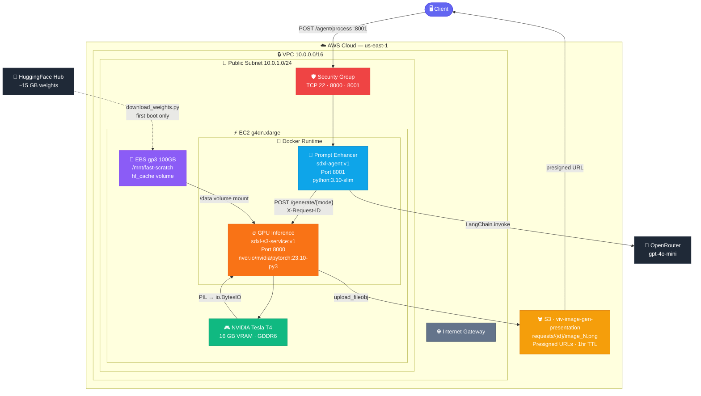
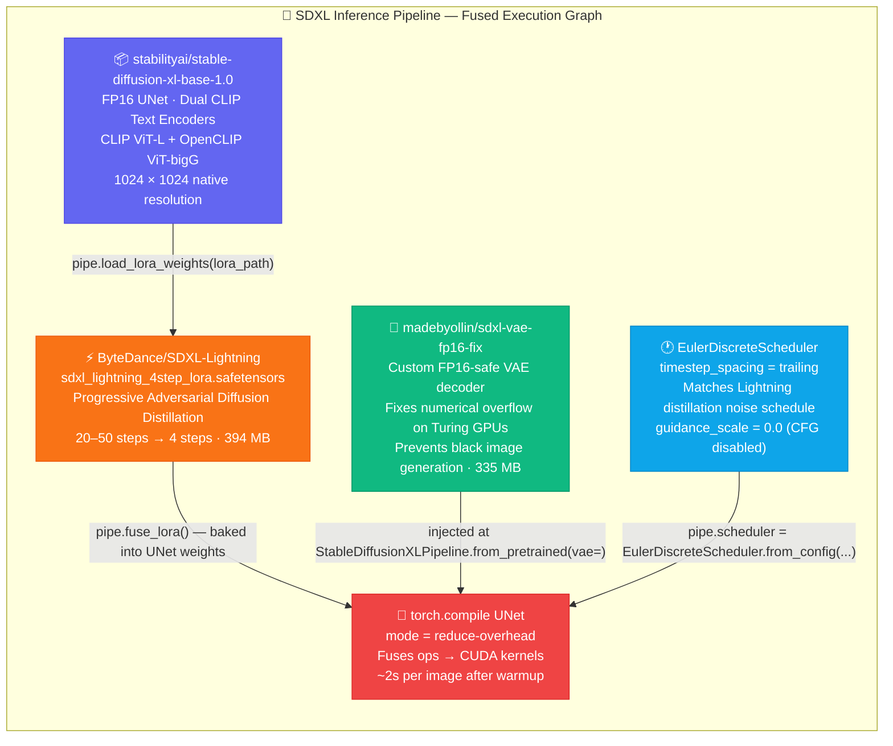
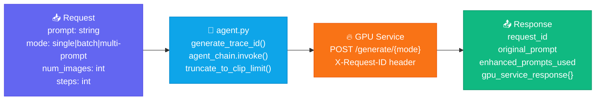
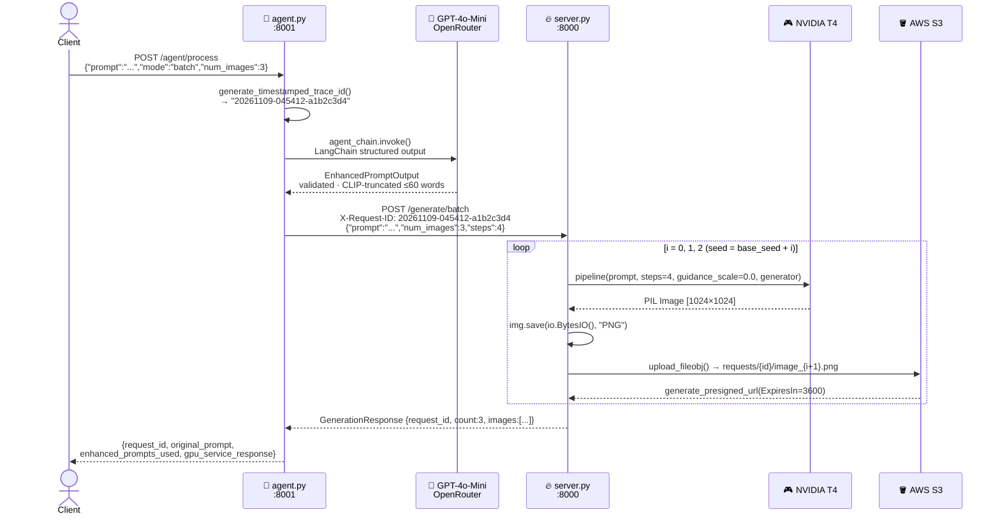
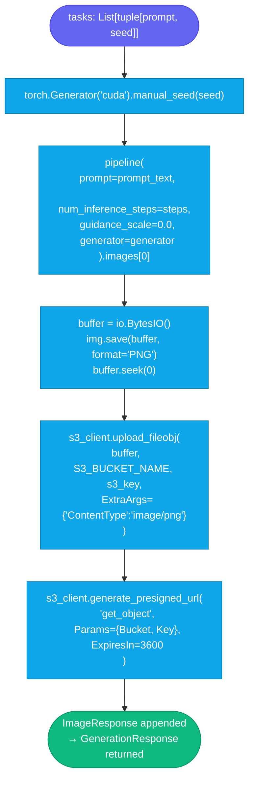
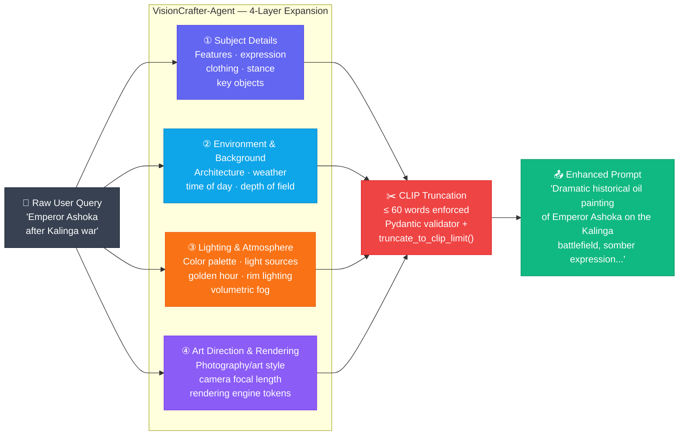
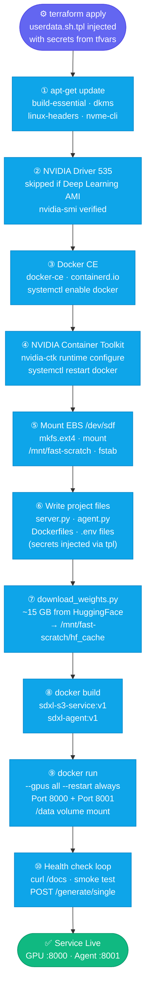

# 🔬 SDXL Lightning — Deep Technical Architecture Reference

> This document is the authoritative technical reference for the SDXL image generation service. It covers every component, file, inference flow, API contract, and optimization decision in the system.

---

## 1. System Overview

A two-tier microservice system on AWS `g4dn.xlarge` (NVIDIA Tesla T4). A plain-language query enters **Tier 1** (LangChain agent), gets transformed into a structured SDXL prompt, then forwarded to **Tier 2** (GPU inference engine) which renders the image and streams it directly to S3 — returning a 1-hour presigned URL.



---

## 2. Infrastructure

| Component | Specification |
|---|---|
| Instance | `g4dn.xlarge` — 4 vCPU, 16 GB RAM |
| GPU | NVIDIA Tesla T4 — 16 GB VRAM, GDDR6, Turing (sm_75) |
| Root Volume | 80 GB gp3 EBS |
| Scratch Volume | 100 GB gp3 EBS → `/mnt/fast-scratch` → container `/data` |
| Container Runtime | Docker CE + NVIDIA Container Toolkit (`--gpus all`) |
| Restart Policy | `--restart always` on both containers |
| S3 Bucket | `viv-image-gen-presentation` (us-east-1) |

---

## 3. Project File Structure

```
Image_generation/
│
├── 📄 server.py                 # FastAPI GPU inference engine — Port 8000
├── 📄 Dockerfile                # nvcr.io/nvidia/pytorch:23.10-py3 base image
├── 📄 requirements.txt          # Pinned GPU service Python deps
├── 📄 download_weights.py       # One-time HuggingFace weight pre-fetcher
├── 📄 .env                      # AWS_ACCESS_KEY_ID · AWS_SECRET_KEY · HF_TOKEN
│
├── prompt_enhancer/
│   ├── 📄 agent.py              # LangChain prompt enhancer — Port 8001
│   ├── 📄 Dockerfile            # python:3.10-slim base image
│   ├── 📄 requirements.txt      # LangChain · FastAPI · OpenAI deps
│   └── 📄 .env                  # OPENROUTER_API_KEY · SDXL_SERVICE_URL
│
└── terraform/
    ├── 📄 main.tf               # VPC · SG · EC2 · EBS · Key Pair
    ├── 📄 variables.tf          # All input variables with defaults
    ├── 📄 outputs.tf            # Public IP · SSH cmd · service URLs
    ├── 📄 terraform.tfvars      # Your secrets — fill before apply
    └── 📄 userdata.sh.tpl       # Full 10-step EC2 bootstrap script
```

---

## 4. File Responsibilities

### `server.py` — GPU Inference Engine

Core FastAPI app. Startup sequence (executed once at container start):


All three endpoints share `process_generation_tasks(tasks, steps)`:

```
GPU inference → io.BytesIO PNG encode → s3_client.upload_fileobj() → generate_presigned_url()
```

### `agent.py` — Prompt Enhancer Agent

LangChain FastAPI service. Per-request flow:

1. `generate_timestamped_trace_id()` → `YYYYMMDD-HHMMSS-<8-char-uuid>`
2. `agent_chain.invoke()` → LangChain → OpenRouter → `gpt-4o-mini`
3. `llm.with_structured_output(EnhancedPromptOutput)` → Pydantic-validated list
4. Double-safety CLIP truncation: Pydantic `field_validator` + `truncate_to_clip_limit()` → ≤ 60 words
5. Route to correct GPU endpoint based on `mode`
6. Forward `X-Request-ID` header for distributed tracing

### `download_weights.py` — Weight Pre-fetcher

Runs once on the EC2 host (step 7 of `userdata.sh.tpl`) before Docker build. Downloads all three model artifacts into `/mnt/fast-scratch/sdxl-data/hf_cache` so the container reads from NVMe on every subsequent cold boot instead of re-downloading from HuggingFace.

### `Dockerfile` (GPU service)

```dockerfile
FROM nvcr.io/nvidia/pytorch:23.10-py3   # CUDA 12.1 + cuDNN pre-installed
# installs pinned requirements.txt
# copies server.py
# EXPOSE 8000
# CMD uvicorn server:app --host 0.0.0.0 --port 8000
```

### `Dockerfile` (prompt_enhancer)

```dockerfile
FROM python:3.10-slim                   # no GPU needed
# installs LangChain + FastAPI deps
# copies agent.py
# EXPOSE 8001
# CMD uvicorn agent:app --host 0.0.0.0 --port 8001
```

### `requirements.txt` (GPU service) — key pins

| Package | Version | Reason |
|---|---|---|
| `torch` | `2.1.2+cu121` | SDPA + `torch.compile` support |
| `diffusers` | `0.26.3` | Stable SDXL pipeline API |
| `huggingface-hub` | `<0.25.0` | Avoids breaking API changes |
| `numpy` | `<2.0.0` | diffusers internal compatibility |
| `safetensors` | `0.4.2` | LoRA checkpoint loading |
| `boto3` | `1.34.50` | S3 upload + presigned URL |

### `.env` files

| File | Variables |
|---|---|
| `.env` (root) | `AWS_ACCESS_KEY_ID`, `AWS_SECRET_KEY`, `HF_TOKEN` |
| `prompt_enhancer/.env` | `OPENROUTER_API_KEY`, `SDXL_SERVICE_URL=http://localhost:8000` |

> `SDXL_SERVICE_URL` uses `localhost` because both containers run on the same EC2 host and communicate over the host network.

---

## 5. AI Model Architecture



### Model Component Reference

| Component | Model ID | Size | Role |
|---|---|---|---|
| Base UNet | `stabilityai/stable-diffusion-xl-base-1.0` | ~6.9 GB | FP16 UNet + dual CLIP text encoders |
| Text Encoder 1 | CLIP ViT-L (inside base) | — | Short prompt tokens |
| Text Encoder 2 | OpenCLIP ViT-bigG (inside base) | — | Long-range semantic context |
| Distillation LoRA | `ByteDance/SDXL-Lightning` | ~394 MB | 4-step ADD distillation |
| VAE | `madebyollin/sdxl-vae-fp16-fix` | ~335 MB | FP16-safe latent decoder |
| Scheduler | `EulerDiscreteScheduler` | — | Trailing timestep noise schedule |

**Total cached weight storage: ~7.6 GB** at `/mnt/fast-scratch/sdxl-data/hf_cache`

### Why `guidance_scale=0.0`

SDXL-Lightning's distillation training bakes classifier-free guidance directly into the UNet weights. Setting `guidance_scale=0.0` disables the standard CFG double-pass, halving inference compute while maintaining quality — this is a hard requirement of the Lightning architecture.

### Why `fuse_lora()` instead of keeping the adapter

`pipe.fuse_lora()` merges the LoRA delta weights directly into the base UNet tensors. This eliminates the adapter forward-pass overhead on every inference call. The trade-off is that the LoRA cannot be unloaded after fusion, but since this service runs a single fixed model, that is the correct choice.

---

## 6. Hardware & Optimization Stack

```mermaid
flowchart LR
    subgraph GPU["🎮 NVIDIA Tesla T4 — 16 GB VRAM"]
        direction TB
        FP16["FP16 Precision\ntorch.float16\n~50% VRAM vs FP32"]:::opt
        SDPA["PyTorch 2.x SDPA\nNative Scaled Dot-Product Attention\nReplaces xformers"]:::opt
        COMP["torch.compile\nreduce-overhead mode\nCUDA kernel fusion\n~2s per image"]:::opt
        ATTN["enable_attention_slicing()\nChunked attention\nPrevents OOM on batches"]:::opt
        VAES["enable_vae_slicing()\nSliced latent decode\nPrevents OOM on batches"]:::opt
    end

    subgraph IO["💾 I/O Pipeline"]
        direction TB
        BUF["io.BytesIO buffer\nIn-memory PNG encode\nZero host disk I/O"]:::io
        S3UP["s3_client.upload_fileobj()\nDirect GPU → S3 stream\nNo temp file written"]:::io
        CACHE["NVMe hf_cache\n/mnt/fast-scratch\nEliminates cold-boot downloads"]:::io
    end

    GPU --> IO

    classDef opt fill:#6366f1,stroke:#4f46e5,color:#fff
    classDef io fill:#f59e0b,stroke:#d97706,color:#fff
```



| Optimization | Code | Effect |
|---|---|---|
| FP16 precision | `torch_dtype=torch.float16` | ~50% VRAM vs FP32 |
| 4-step distillation | `fuse_lora()` + `steps=4` | 20–50 steps → 4 steps |
| PyTorch 2.x SDPA | built-in (torch 2.1.2) | replaces xformers |
| Graph compilation | `torch.compile(mode="reduce-overhead")` | ~2s/image after warmup |
| Attention slicing | `pipe.enable_attention_slicing()` | prevents VRAM OOM on batches |
| VAE slicing | `pipe.enable_vae_slicing()` | prevents VRAM OOM on decode |
| In-memory streaming | `io.BytesIO` | zero disk I/O |
| NVMe weight cache | `/mnt/fast-scratch/sdxl-data/hf_cache` | no re-download on cold boot |
| FP16 VAE fix | `madebyollin/sdxl-vae-fp16-fix` | prevents black images on T4 |


---

## 7. API Reference

### Tier 1 — Prompt Enhancer Agent · Port 8001

#### `POST /agent/process`



**Request schema:**

```json
{
  "prompt": "Emperor Ashoka after Kalinga war",
  "mode": "single | batch | multi-prompt",
  "num_images": 3,
  "steps": 4
}
```

**Mode behaviour:**

| Mode | Agent sends to GPU | GPU endpoint | Result |
|---|---|---|---|
| `single` | 1 enhanced prompt | `POST /generate/single` | 1 image |
| `batch` | 1 enhanced prompt | `POST /generate/batch` | N seed variations |
| `multi-prompt` | N distinct prompts | `POST /generate/multi-prompt` | N images, 1 per perspective |

**Full response payload:**

```json
{
  "request_id": "20261109-045412-a1b2c3d4",
  "original_prompt": "Electrolysis of water experiment setup",
  "mode": "single",
  "enhanced_prompts_used": [
    "Scientific laboratory photo of a glass Hoffmann voltameter filled with acidified water. Platinum electrodes producing oxygen and hydrogen bubbles at anode and cathode. Clear volumetric marks, lab bench background, soft ring-light illumination, crisp reflections, textbook 3D render quality."
  ],
  "gpu_service_response": {
    "request_id": "20261109-045412-a1b2c3d4",
    "count": 1,
    "images": [
      {
        "request_id": "20261109-045412-a1b2c3d4",
        "prompt": "Scientific laboratory photo of a glass Hoffmann voltameter...",
        "s3_key": "requests/20261109-045412-a1b2c3d4/image_1.png",
        "seed_used": 3923427293,
        "url": "https://viv-image-gen-presentation.s3.amazonaws.com/requests/.../image_1.png?AWSAccessKeyId=...&Expires=1794182748"
      }
    ]
  }
}
```

---

### Tier 2 — GPU Inference Engine · Port 8000

All three endpoints share the same `GenerationResponse` schema. They can be called directly without the agent.

#### `POST /generate/single` — 1 prompt → 1 image

```json
{ "prompt": "...", "steps": 4, "seed": 42 }
```

Seed is optional — if omitted, `random.randint(0, 2**32 - 1)` is used.

#### `POST /generate/batch` — 1 prompt → N seed variations

```json
{ "prompt": "...", "num_images": 6, "steps": 4 }
```

Seeds assigned as `base_seed + i` for `i in range(num_images)` — guarantees deterministic variation across the batch.

#### `POST /generate/multi-prompt` — N prompts → N images

```json
{ "prompts": ["oil painting style...", "anime style...", "cyberpunk style..."], "steps": 4 }
```

Each prompt gets an independent `random.randint` seed.

**Shared `GenerationResponse` schema:**

```json
{
  "request_id": "<uuid>",
  "count": 3,
  "images": [
    {
      "request_id": "<uuid>",
      "prompt": "...",
      "s3_key": "requests/<uuid>/image_1.png",
      "seed_used": 3923427293,
      "url": "https://viv-image-gen-presentation.s3.amazonaws.com/...?Expires=..."
    }
  ]
}
```

---

## 8. End-to-End Request Lifecycle



### Internal `process_generation_tasks()` flow



---

## 9. Prompt Enhancement — 4-Layer Design

Every prompt generated by `agent.py` covers four structured layers, per `plan.txt` and the `SYSTEM_PROMPT` in `agent.py`:



**Constraints enforced in `agent.py`:**

| Rule | Mechanism |
|---|---|
| Hard CLIP limit ≤ 60 words | Pydantic `field_validator` + `truncate_to_clip_limit()` (double safety) |
| User override respected | System prompt rule: explicit style/background/aspect ratio is never overridden |
| No generic buzzwords | System prompt bans `masterpiece`, `best quality`, `hyperrealistic` |
| Domain accuracy | Few-shot examples cover Chemistry, History, Biology, Mathematics, Literature |

---

## 10. S3 Storage Layout

```
viv-image-gen-presentation/          ← S3 bucket (us-east-1)
└── requests/
    └── {YYYYMMDD-HHMMSS-uuid}/      ← one folder per request
        ├── image_1.png              ← ContentType: image/png
        ├── image_2.png
        └── image_N.png
```

- Presigned URLs expire after **1 hour** (`ExpiresIn=3600`)
- No intermediate disk write — GPU tensor → `io.BytesIO` → `upload_fileobj()` → S3
- Trace ID format: `20261109-045412-a1b2c3d4` (date + time + 8-char UUID)

---

## 11. Terraform Bootstrap — 10-Step Sequence



**Bootstrap timeline:**

| Time | Step |
|---|---|
| 0–2 min | System update, NVIDIA driver check, Docker install, NVIDIA Container Toolkit |
| 2–4 min | EBS mount + format, all project files written to disk with secrets injected |
| 4–12 min | `download_weights.py` — ~15 GB model weights from HuggingFace Hub |
| 12–14 min | `docker build` both images |
| 14–17 min | Containers start, pipeline loads into VRAM, `torch.compile` warmup pass |
| ~17 min | Smoke test fires → service live |

**Watch live:**
```bash
ssh -i ~/.ssh/id_rsa ubuntu@<PUBLIC_IP> 'tail -f /var/log/sdxl-bootstrap.log'
```
